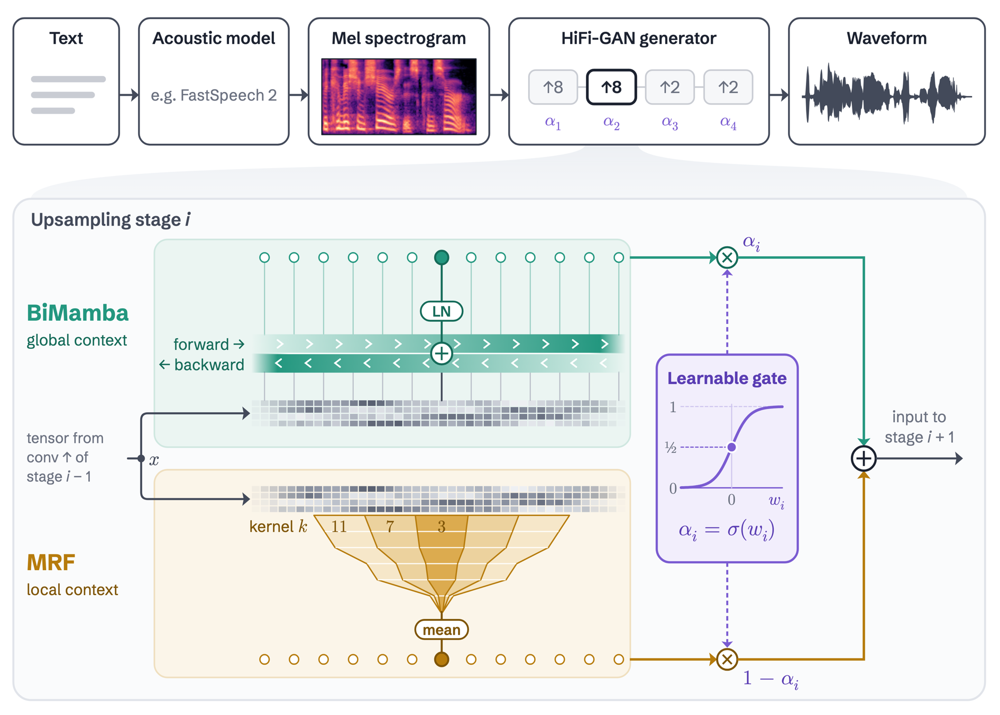

<div align="center">

<h1>Mamba HiFi-GAN: Integrating Bidirectional Mamba into HiFi-GAN for Long-Range Speech Synthesis</h1>

**Course project · CS 585, Bilkent · Fall 2025-26**

[Hüseyin Karaca](https://hkaraca.com/), Rabia Ela Ünlü, Emre Can Yayla<br>
Bilkent University

[Paper](https://hkaraca.com/mamba-hifigan/assets/report.pdf) ·
[Project page](https://hkaraca.com/mamba-hifigan/) ·
[Slides](https://hkaraca.com/mamba-hifigan/assets/slides.pdf) ·
[Audio samples](https://hkaraca.com/mamba-hifigan/#samples)

</div>

Mamba HiFi-GAN is a neural vocoder that runs a bidirectional Mamba branch beside HiFi-GAN's MRF convolutions
at every upsampling stage and mixes the two with one learnable gate per stage. On LJSpeech its final
feature-matching loss is 0.0623, 15% lower than HiFi-GAN's 0.0736, and it leads all 11 alternative designs.
This repository holds the code for all nineteen generator placements we tried, one hparams file per run, and
every logged loss.

<p align="center"></p>
<p align="center"><em>At every upsampling stage, one learnable gate mixes a BiMamba branch with HiFi-GAN's
MRF convolutions.</em></p>

## Installation

Linux with an NVIDIA GPU and the CUDA toolkit (`nvcc`), which `mamba-ssm` uses.
<!-- TODO: tested versions (Python, PyTorch, CUDA, GPU model and memory). -->

```bash
git clone https://github.com/huseyin-karaca/mamba-hifigan.git && cd mamba-hifigan
pip install -e .                                   # torch, speechbrain
pip install mamba-ssm "causal-conv1d>=1.2.0"       # builds CUDA kernels, 30-40 min
```

## Quick start

This builds the proposed generator and runs a random mel-spectrogram through it. Run it from the repo root on
a GPU.

```python
import torch
from mambahifigan import HifiganGeneratorHybrid1GatedFusion

g = HifiganGeneratorHybrid1GatedFusion(
    80, 1, "1", [[1, 3, 5]] * 3, [3, 7, 11], [16, 16, 4, 4], 512, [8, 8, 2, 2], d_state=64
).cuda()
mel = torch.randn(1, 80, 100, device="cuda")       # 100 frames, hop 256
print(g(mel).shape)                                # torch.Size([1, 1, 25600])
print([torch.sigmoid(w).item() for w in g.mixing_gates])   # [0.5, 0.5, 0.5, 0.5]
```

Every other generator is listed in `mambahifigan.GENERATORS` and takes the same arguments.

## Data

Training uses [LJSpeech 1.1](https://keithito.com/LJ-Speech-Dataset/) (public domain; 13,100 clips, 24 h,
22.05 kHz). `scripts/setup.sh` downloads it (2.6 GB); the recipe builds a 90/10 train/valid split on first run.

## Reproducing the paper

Set up SpeechBrain at the pinned commit `637f0a55` with this repo's recipe script, install this package and
download LJSpeech, all into `<workdir>`:

```bash
bash scripts/setup.sh <workdir>
cd <workdir>/speechbrain/recipes/LJSpeech/TTS/vocoder/hifigan
```

Then train one configuration, where `<repo>` is this checkout and `<config>` a file name from the table:

```bash
python train.py <repo>/hparams/<config>.yaml --data_folder <workdir>/LJSpeech-1.1
```

Each run is 50 epochs, batch size 16, seed 1234: a few hours on one GPU. It writes checkpoints, logs and audio
samples to `results/hifi_gan/<config>_1234/` under the recipe directory.
<!-- TODO: GPU model and wall-clock per run. -->

| Paper, Table 1 | `<config>` | Expected FM ↓ | Expected L1 ↓ |
|---|---|--:|--:|
| Baseline (HiFi-GAN) | `baseline` | 0.0736 | 0.2975 |
| Mamba Only (No Conv) | `mamba_only` | 0.1291 | 0.3307 |
| Hybrid 2 (Summation Fusion) | `hybrid2_summation_mamba64` | 0.0711 | 0.2991 |
| **Hybrid 1 (Mamba64 Gated)** | `hybrid1_gated_mamba64` | **0.0623** | 0.2806 |
| Hybrid 1 (Mamba128 Gated) | `hybrid1_gated_mamba128` | 0.0771 | **0.2587** |

FM is the generator's feature-matching loss and L1 its mel-spectrogram L1 loss, both at the final epoch of
one run with seed 1234. The first three rows use 8,192-sample segments, the gated rows 12,288.

The 11 alternative designs on the project page's chart come from Table 2 and Appendix A.4 of the paper.
[`results/experiments.csv`](results/experiments.csv) lists every run with its `<config>` (column `slug`),
its name in the paper (`reported_as`) and its expected losses.

## Repository layout

```text
src/mambahifigan/   the generators, one module per design family; gated.py is the proposal
recipe/train.py     SpeechBrain's HiFi-GAN recipe script with W&B logging and a min-duration filter
scripts/setup.sh    installs SpeechBrain 637f0a55, the recipe script, this package and LJSpeech
hparams/            one YAML per run, each naming its generator and final losses
results/            final losses per run, and every loss at every epoch
docs/               the project page (index.html), with the audio and the PDFs
```

## License

Code: [Apache-2.0](LICENSE), matching SpeechBrain, from which the generators are derived. Project-page text
and figures: CC BY 4.0. The audio is derived from LJSpeech (public domain).

## Acknowledgements

Built on [SpeechBrain](https://github.com/speechbrain/speechbrain)'s HiFi-GAN recipe and the
[`mamba-ssm`](https://github.com/state-spaces/mamba) Mamba2 kernels.
